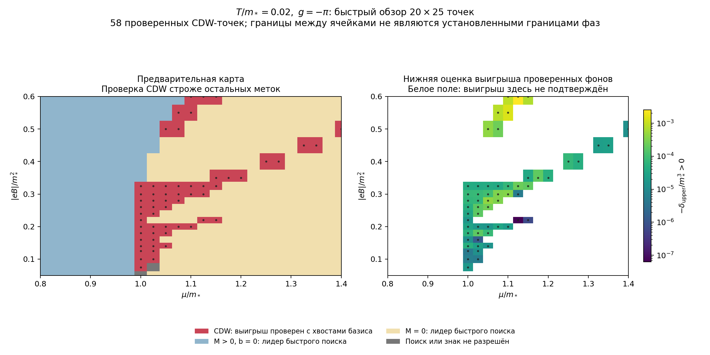

# theoretical-physics-lab

Исследования по отдельным задачам теоретической физики. Каждая задача — в своём каталоге.

## Задачи

| Каталог | Задача | Статус |
|---|---|---|
| [cdw-magnetic](cdw-magnetic/README.md) | CDW-фаза в NJL₃-модели (2+1) с μ во внешнем перпендикулярном магнитном поле B | аналитическое представление TDP, проверки, предварительная карта фаз |

## Результаты: CDW в магнитном поле

При $T/m_*=0.02$, $g=-\pi$ построена [предварительная карта из 500 точек](cdw-magnetic/notes/16-preliminary-phase-map.md) в области $0.8\le\mu/m_*\le1.4$, $0.05\le|eB|/m_*^2\le0.6$. В 58 узлах найден неоднородный фон с проверенным выигрышем у численно найденного однородного минимума. Остальные метки предварительны; точные фазовые границы и предел $T\to0$ ещё не установлены.

- [Карта, интерпретация цветов и проверки](cdw-magnetic/notes/16-preliminary-phase-map.md).
- [Вывод полного потенциала при конечных μ,T](cdw-magnetic/notes/09-finite-density.md).
- [Сечения по μ,B и независимый бесполевой контроль](cdw-magnetic/notes/15-continuation-and-zero-field-control.md).
- [Рабочий план и оставшиеся задачи](cdw-magnetic/notes/00-plan.md).
- [Код, отчёты и команды воспроизведения](https://github.com/AlexeyKozhakin/theoretical-physics-lab/tree/main/cdw-magnetic/code).

## Статьи

Статьи, на которые опираются задачи. Они хранятся локально в каталоге `papers/` и в репозиторий не входят (см. `.gitignore`):

- `3dimCDW+L_v4-4.pdf` — K. G. Klimenko, A. Kozhakin, R. N. Zhokhov, *Inhomogeneous chiral density wave phase in the (2+1)-dimensional NJL model with compactified spatial coordinate*.
- `1307.7265v3.pdf` — K. G. Klimenko, R. N. Zhokhov, *Magnetic catalysis effect in the (2+1)-dimensional Gross–Neveu model with Zeeman interaction*, arXiv:1307.7265.

## Соглашения

- Заметки пишутся на русском; формулы, обозначения и термины — как в статьях.
- Формат — Markdown с формулами `$...$` / `$$...$$`. Просмотр: сайт <https://alexeykozhakin.github.io/theoretical-physics-lab/>, предпросмотр VS Code (`Cmd+Shift+V`) или GitHub.
- Новая страница появится в меню сайта, только если добавить её в `nav` в `mkdocs.yml`.
- Локальный просмотр сайта: `pip install -r requirements.txt && mkdocs serve`, затем <http://127.0.0.1:8000>.
- Ссылки на формулы статей: «(43) [CDW]» — формула (43) из `3dimCDW+L_v4-4.pdf`, «(25) [MC]» — формула (25) из `1307.7265v3.pdf`.
