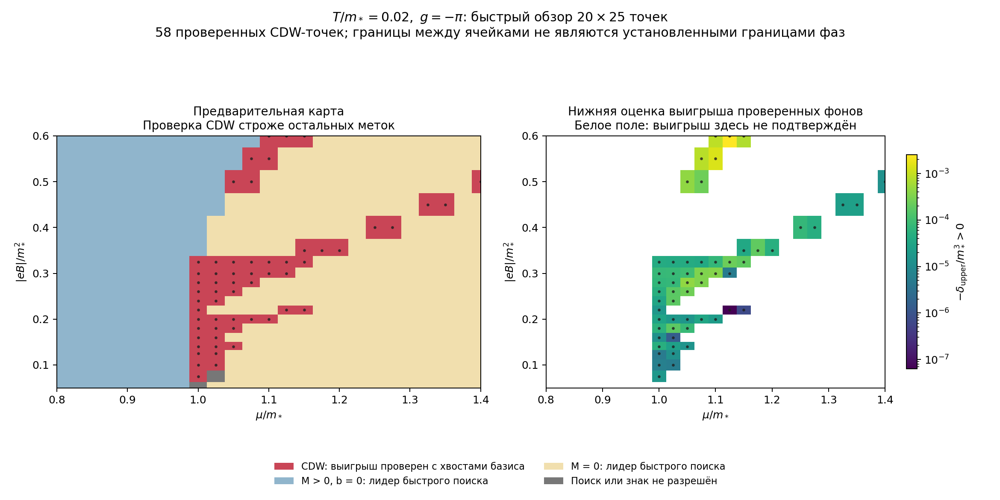

# CDW в NJL₃ во внешнем магнитном поле

Задача идёт по двум веткам с общей моделью (дословные постановки — [tasks.md](tasks.md)):

- **Ветка A — TDP с CDW-анзацем:** подставить анзац (8) [CDW] в поле и вычислить TDP. Текущий [рабочий план](notes/00-plan.md), заметки 01–16 ниже.
- **Ветка B — анализ устойчивости:** устойчив ли однородный минимум в поле к малым неоднородным флуктуациям, как в Appendix F [CDW]. План: [notes/stability/00-plan.md](notes/stability/00-plan.md). План согласован (R7–R9). Получена уточнённая постановка — разбор в [notes/stability/01-setup.md](notes/stability/01-setup.md), открыты вопросы S4–S7.

## Последний результат

[Первая предварительная карта фаз](notes/16-preliminary-phase-map.md): 500 узлов при T=0.02, в 58 проверен выигрыш CDW. Синие и светлые метки обозначают лидеров быстрого поиска; отсутствие других неоднородных минимумов там не доказано. Фазовые границы требуют уточнения.

[Вывод потенциала](notes/09-finite-density.md) · [Бесполевой контроль](notes/15-continuation-and-zero-field-control.md) · [Код и воспроизведение](https://github.com/AlexeyKozhakin/theoretical-physics-lab/tree/main/cdw-magnetic/code).

## Постановка (ветка A)

Берём лагранжиан (1) [CDW] с химическим потенциалом $\mu$ в (2+1) измерениях **без компактификации** (обе пространственные координаты бесконечны). Добавляем внешнее магнитное поле, перпендикулярное плоскости $(x,y)$, как в [MC]: $\partial \to \partial + ieA$, где

$$A_{0,1}=0,\quad A_2 = Bx,\quad A_3 = 0 \qquad\Rightarrow\qquad B_x=B_y=0,\ B_z=B=\text{const}.$$

Для конденсатов используем анзац CDW (8) [CDW] с $\vec l=(2b,0)$:

$$\langle\sigma\rangle = M\cos 2bx,\qquad \langle\pi\rangle = M\sin 2bx.$$

**Цель:** найти TDP $\Omega(M,b;\mu,B,T)$ в главном порядке $1/N$ с контролем предела $T\to0$ и выяснить, может ли поле $B$ индуцировать CDW-фазу, которой при $B=0$ нет (раздел IV [CDW]).

Обозначения: [CDW] = `../papers/3dimCDW+L_v4-4.pdf`, [MC] = `../papers/1307.7265v3.pdf`.

## Статус (2026-11-07)

Постановка ветки A уточнена: один мультиплет, без зеемановского члена. Согласовано выводить потенциал при конечном $T$ и получать $T=0$ предельным переходом. Сведение к AQRM проверено в явных матрицах; получены явный интегральный ряд теплового следа и перенормированный вакуумный потенциал. При $\mu=0$, $T\ge0$ доказано предпочтение однородного состояния перед CDW при той же амплитуде. Получено аналитическое представление полного потенциала при произвольном конечном $\mu$, $T>0$, $|eB|>0$ и проверен бесполевой предел. Для практического счёта выведен и реализован относительный определитель Шура без отдельного поиска уровней. Получены также аналитические границы хвоста базиса в контролируемой области и отдельные границы теплового спектра; контроль расширен на сильное смешивание через исключённый блок и связь Шура. Адаптивный поиск обнаружил кандидат CDW при $|eB|=0.2$, $\mu=1.05$, $T=0.02$; локальный поиск уточнил его положение до $M\simeq0.1120$, $b\simeq0.79954$, отрицательный знак проверен до базиса 512. В двух соседних сечениях подтверждены 15 различных кандидатов; при B=0 исходный неоднородный фон с теми же μ,T проигрывает однородному. Однородные минимумы проверены на опорных точках. Построена предварительная карта 20×25 точек: в 58 подтверждён выигрыш CDW; остальные метки предварительны, точные границы пока не установлены. Результат — аналитический вид TDP через интегралы, суммы или спецфункции; далее — минимизация по $M,b$ и диаграммы $(\mu,B)$ при фиксированных температурах ([вопросы](questions.md), R5, R10).

**Текущий план:** [00. TDP при конечной температуре через модель Раби](notes/00-plan.md). Этапы A1–A6 выполнены: [начало вывода](notes/07-derivation-operators.md), [вакуум](notes/08-heat-kernel-vacuum.md), [полный TDP при произвольном $\mu$](notes/09-finite-density.md). Основные проверки A7 согласованы, включая [предел $B\to0$](notes/10-zero-field-limit.md). Относительный расчёт реализован и проверен в [11-relative-determinant](notes/11-relative-determinant.md). Границы базиса и первые однородные минимумы — [12-basis-bounds-and-homogeneous](notes/12-basis-bounds-and-homogeneous.md). Адаптивный поиск, новые границы и первый кандидат — [13-adaptive-search-and-cdw-candidate](notes/13-adaptive-search-and-cdw-candidate.md). Локальное уточнение кандидата и проверка до N=512 — [14-local-cdw-minimum](notes/14-local-cdw-minimum.md). Два сечения по μ и B, аналитический бесполевой вакуум и конечная температура — [15-continuation-and-zero-field-control](notes/15-continuation-and-zero-field-control.md). Первая [предварительная карта 20×25](notes/16-preliminary-phase-map.md) построена. [Быстрый движок](notes/17-fast-engine.md) воспроизводит её CDW-точки с глобальным поиском по (M,b). Далее — конкурирующие минимумы на выбранных участках, уточнение границ и температурные проверки.

Главная трудность — смешивание уровней Ландау при $\vec l\perp\vec B$. Сведение $H^2$ к асимметричной модели Раби проверено в [07-derivation-operators](notes/07-derivation-operators.md); первоначальная идея — [06-rabi-heat-kernel](notes/06-rabi-heat-kernel.md). Полный TDP задан аналитическими рядами и интегралами с контролируемым разделением низких уровней; CDW при $\mu=0$ исключена в выбранном анзаце. При конечной плотности найден первый кандидат ниже однородного семейства; глобальная минимизация и фазовые границы остаются открытыми. Разложения по $M$, по $b$ и LLL остаются дополнительными подходами; при $T=0$ аналитичность по $M$ требует проверки. Приоритет AQRM согласован (R10). Подтверждение сведения само по себе не определяет фазовую диаграмму.

## Ключевые выводы

1. Киральный поворот $q_w = e^{i\gamma^5 bx}q$ из (12) [CDW] работает и в поле: он коммутирует с $\nabla_2=\partial_2+ieBx$. → [01-setup](notes/01-setup.md)
2. После поворота член $b\,\gamma^5\gamma^1$ смешивает уровни Ландау. Параметр смешивания $\kappa = 2b^2/(eB)$, т.е. $(b\,\ell_B)^2$ с точностью до множителя. Обычная диагонализация по уровням не работает; это не исключает аналитического представления через AQRM. → [02-difficulty](notes/02-difficulty.md)
3. Предельные случаи для проверки: $b=0$ → (21), (25) [MC] для одного мультиплета; $B\to0$ → (43) [CDW]; сильное поле (LLL) → эффективная щель $\sim M e^{-b^2/eB}$ (гипотеза). → [03-limits](notes/03-limits.md)
4. Обрезание по импульсу в поле неприменимо: нужна регуляризация по собственным значениям и аналог вычитания (37) [CDW]. Для статического потенциала поворот обоснован через унитарную эквивалентность гамильтонианов при согласованной спектральной регуляризации; это не общий вывод об аномалиях. → [04-renorm](notes/04-renorm.md)
5. Получено представление полного TDP через AQRM, тепловое ядро и отдельный учёт низких уровней при конечной плотности. Разложение по $M$, если оно существует, даёт восприимчивость на волновом векторе $2b$ и критерий линейной неустойчивости, но ещё не доказательство устойчивой CDW-фазы. → [05-strategy](notes/05-strategy.md), [06-rabi-heat-kernel](notes/06-rabi-heat-kernel.md)

## Структура каталога

| Файл | Содержание |
|---|---|
| [tasks.md](tasks.md) | Дословные постановки обеих веток |
| [questions.md](questions.md) | Открытые вопросы и принятые решения |
| [findings.md](findings.md) | Журнал результатов по датам |
| [notes/00-plan.md](notes/00-plan.md) | Текущий план ветки A: конечная температура, AQRM, перенормировка и фазовые диаграммы |
| [notes/01-setup.md](notes/01-setup.md) | Модель, анзац, калибровка, киральный поворот |
| [notes/02-difficulty.md](notes/02-difficulty.md) | Смешивание уровней Ландау и трудности диагонализации |
| [notes/03-limits.md](notes/03-limits.md) | Предельные случаи и проверки |
| [notes/04-renorm.md](notes/04-renorm.md) | Регуляризация, перенормировка, аномалия |
| [notes/05-strategy.md](notes/05-strategy.md) | План получения аналитического TDP |
| [notes/06-rabi-heat-kernel.md](notes/06-rabi-heat-kernel.md) | Предварительное сведение к AQRM, тепловое ядро и ограничения GL-разложения |
| [notes/07-derivation-operators.md](notes/07-derivation-operators.md) | Вывод операторов и температурного веса, проверка AQRM, нормировка и нулевые моды |
| [notes/08-heat-kernel-vacuum.md](notes/08-heat-kernel-vacuum.md) | Явный тепловой след, перенормировка и отсутствие CDW при $\mu=0$, $T\ge0$ в выбранном анзаце |
| [notes/09-finite-density.md](notes/09-finite-density.md) | Полный TDP при произвольном $\mu$, целая спектральная функция и сходящаяся тепловая часть |
| [notes/10-zero-field-limit.md](notes/10-zero-field-limit.md) | Проверка полного предела $B\to0$, включая бесщелевые режимы |
| [notes/11-relative-determinant.md](notes/11-relative-determinant.md) | Определитель Шура, ускоренная частотная сумма, численный прототип и ложные сигналы малого базиса |
| [notes/12-basis-bounds-and-homogeneous.md](notes/12-basis-bounds-and-homogeneous.md) | Аналитические границы хвоста базиса, однородные минимумы и первые проверки модуляций |
| [notes/13-adaptive-search-and-cdw-candidate.md](notes/13-adaptive-search-and-cdw-candidate.md) | Адаптивный поиск, контроль сильного смешивания и первый кандидат CDW |
| [notes/14-local-cdw-minimum.md](notes/14-local-cdw-minimum.md) | Уточнение локального минимума, сходимость и пять этапов до фазовой диаграммы |
| [notes/15-continuation-and-zero-field-control.md](notes/15-continuation-and-zero-field-control.md) | Два сечения поиска, независимый B=0 потенциал и контроль роли поля |
| [notes/16-preliminary-phase-map.md](notes/16-preliminary-phase-map.md) | Первая карта μ,B: 500 узлов, 58 проверенных CDW-кандидатов, ограничения и следующий шаг |
| [notes/17-fast-engine.md](notes/17-fast-engine.md) | Быстрый движок карт: глобальная сетка (M,b), ленточная форма Раби, кэш вакуума, замеры скорости |
| [notes/stability/00-plan.md](notes/stability/00-plan.md) | Ветка B: план анализа устойчивости, трудности |
| [notes/stability/01-setup.md](notes/stability/01-setup.md) | Ветка B: уточнённая постановка, блочная структура, вид ответа |
| `code/` | Воспроизводимые проверки, численные потенциалы и предварительная карта |
| `figures/` | Предварительная карта фаз, координаты конденсатов, сечения и проверки |
