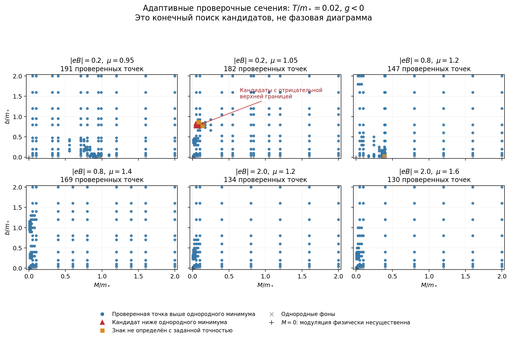

# 13. Адаптивный поиск и первый кандидат CDW

Дата: 2026-11-06. Продолжение этапа A8 [плана](00-plan.md) и [границ базиса](12-basis-bounds-and-homogeneous.md).

**Результат:** при $g=-\pi$, $T=0.02$, $\mathcal B=|eB|=0.2$, $\mu=1.05$ найден неоднородный фон $M=0.1$, $b=0.8$, потенциал которого ниже численно найденного однородного минимума. Знак сохраняется после учёта пропущенного базиса и увеличения его размера. Это кандидат CDW, а не готовая фазовая диаграмма или доказательство глобального минимума по непрерывным $M,b$.

Все величины выражены через $m_*=\pi/|g|=1$: $M,b,\mu,T$ в единицах $m_*$, $\mathcal B$ — $m_*^2$, потенциал на один мультиплет — $m_*^3$.

**Продолжение (2026-11-07):** [заметка 14](14-local-cdw-minimum.md) уточняет локальный минимум до M≈0.1120, b≈0.79954 и проверяет выигрыш на базисе 512.

## 1. Что сравниваем простыми словами

Недостаточно показать, что модуляция выгодна при заданном $M$: однородное состояние может выбрать другую, более выгодную массу. Поэтому вычисляем

$$
\delta(M,b)=\Omega(M,b)-\Omega_{\mathrm{hom,min}}
=\underbrace{\Omega(M,b)-\Omega(M,0)}_{\text{относительный определитель}}
+\underbrace{\Omega(M,0)-\Omega_{\mathrm{hom,min}}}_{\text{цена выбора массы}}.
$$

Однородный минимум включает $M=0$. При $M=0$ параметр $b$ физически несущественен; эту ветку не считаем CDW. Для каждой точки сохраняем интервал оценки $\delta$, увеличивая число состояний $N=16,32,64,128$ в каждой осцилляторной башне. Кандидат с отрицательной верхней границей перепроверяется хотя бы на двух размерах базиса. Для отдельно выбранного фона ниже использовано также $N=256$.

Начальная сетка дополнена однородной массой, малыми массами и порогами заполнения. Затем трижды добавляются промежуточные точки около перспективных значений. **Оценки относятся к вычисленным точкам, а не ко всем промежуткам сетки.** Неопределённый знак остаётся неопределённым. Однородный минимум проверяется уточнением сетки и расширением области массы; это численная проверка, а не интервальное доказательство глобальности.

## 2. Новая верхняя граница вакуумного хвоста

Оценка из заметки 12 требовала $4b^2<M^2+2\mathcal B$. Теперь можно контролировать также сильное смешивание, если исключённые состояния достаточно высоко по энергии.

Пусть $P$ оставляет первые $N$ состояний обеих башен, $Q=1-P$, $v=2bM$, $d_B=\mathcal B/(2\pi)$ и

$$
L=\begin{pmatrix}L_N&W\\W^\dagger&L_Q\end{pmatrix},\qquad
\gamma_N=M^2+2\mathcal B N-|v|>0,\qquad L_Q\ge\gamma_N.
$$

Поправка к конечному вакуумному результату распадается на две неотрицательные части: смешивание внутри $Q$ и связь $P$ с $Q$. Матрица остатка вычисляется по конечному сжатию точного оператора смещения:

$$
R_N=WW^\dagger=v^2\operatorname{diag}
\left(I-D_ND_N^\dagger,\ I-D_N^\dagger D_N\right).
$$

### Хвост внутри исключённого блока

Обозначим $A_N=M^2+2\mathcal B(N+1)$, $C_N=M^2+2\mathcal B N$, $q=M^2/(2\mathcal B)$ и $\kappa_Q=v^2/(A_NC_N)<1$. Используем $-\ln(1-x)\le x/(1-\kappa_Q)$ и

$$
\int_0^\infty\frac{d\omega}{\pi(a+\omega^2)(c+\omega^2)}
=\frac{1}{2\sqrt a\sqrt c(\sqrt a+\sqrt c)}
\le\frac18(a^{-3/2}+c^{-3/2}).
$$

Суммы квадратов элементов сжатия унитарного $D$ не превышают единицы. Поэтому внутренняя часть хвоста не больше

$$
U_Q=\frac{d_Bv^2}{8(1-\kappa_Q)(2\mathcal B)^{3/2}}
\left[\zeta\!\left(\frac32,N+1+q\right)
+\zeta\!\left(\frac32,N+q\right)\right].
$$

### Связь оставленного и исключённого блоков

Для всех вещественных $\omega$,

$$
W(L_Q+\omega^2)^{-1}W^\dagger\le\frac{R_N}{\gamma_N+\omega^2}.
$$

Если $L_N-R_N/\gamma_N>0$, можно заменить исключённый блок вспомогательной конечной матрицей

$$
H_{\mathrm{aux}}=\begin{pmatrix}
L_N&\sqrt{R_N}\\ \sqrt{R_N}&\gamma_N I_{2N}
\end{pmatrix}>0.
$$

Монотонность логарифма определителя в формуле Шура и интегрирование по $\omega$ дают

$$
U_{\partial}=d_B\left[
\operatorname{Tr}\sqrt{L_N}+2N\sqrt{\gamma_N}
-\operatorname{Tr}\sqrt{H_{\mathrm{aux}}}\right].
$$

Итак, $0\le\varepsilon_{\mathrm{vac},N}\le U_Q+U_{\partial}$. Нижняя оценка через первый вакуумный член из заметки 12 сохраняется. Если применима и прежняя верхняя граница, берётся меньшая из двух. Условия новой оценки проверяются при каждом $N$; при их нарушении требуется увеличить базис, а не приписывать точке знак.

Это аналитические неравенства для точных операторов. Реализация использует обычную арифметику, оценки квадратуры и запас на округление; строгой интервальной сертификации всех вычислений здесь нет. Независимый тест разбивает большую конечную матрицу на $P,Q$ и отдельно проверяет обе части оценки.

## 3. Численно устойчивый первый вакуумный член при малом M

У интеграла первого члена есть масштаб $s\sim M^{-2}$. Обычная адаптивная квадратура может пропустить его при очень малом $M$. Теперь этот вклад вычитается и интегрируется аналитически:

$$
P_{1,\mathrm{vac}}^{\infty}
=\frac{\mathcal B M}{4\pi}\left(1-e^{-2b^2/\mathcal B}\right)
+\text{интеграл остатка}.
$$

Остаток вычисляется по переменной $u=\sqrt{\mathcal B s}$ с аналитической оценкой хвоста за $u=8$. Проверяется и следующий порядок: при $\mathcal B=0.8$, $b=0.4$ отношение остатка к $M^2$ стремится к $0.00497903$ при уменьшении $M$ от $10^{-3}$ до $10^{-6}$. Это проверка именно разрешения малого масштаба, а не только ведущего линейного члена.

## 4. Шесть пробных сечений

Область поиска: $0\le M,b\le2$, $T=0.02$. В таблице «выше» означает выше однородного опорного значения в проверенной точке, «кандидат» — отрицательную верхнюю границу; однородные точки и представитель $M=0$ перечислены отдельно от этих категорий.

| $\mathcal B$ | $\mu$ | $M_{\rm hom}$ | Всего точек | Выше | Кандидаты | Неопределённые |
|---:|---:|---:|---:|---:|---:|---:|
| 0.2 | 0.95 | 0.992739 | 191 | 179 | 0 | 0 |
| 0.2 | 1.05 | 0 | 182 | 148 | 19 | 4 |
| 0.8 | 1.2 | 0.388070 | 147 | 135 | 0 | 3 |
| 0.8 | 1.4 | 0 | 169 | 159 | 0 | 0 |
| 2.0 | 1.2 | 0 | 134 | 126 | 0 | 0 |
| 2.0 | 1.6 | 0 | 130 | 122 | 0 | 0 |

Всего 953 точки; 19 кандидатов принадлежат одному сечению, это не 19 отдельных фаз. У 122 точек отрицательная исходная разность конечного базиса после поправок оказалась ложным сигналом. Ни одна из проверенных границ области не потребовала расширения, но отсутствие пропущенных минимумов между точками этим не доказано.

## 5. Отдельная проверка кандидата

При $\mathcal B=0.2$, $\mu=1.05$, $T=0.02$, $M=0.1$, $b=0.8$ однородный опорный минимум — $M=0$, $\Omega_{\rm hom}=-0.0616635895287$. Его значение согласуется при расширении области массы до 4, 6 и 8 и сгущении исходной сетки со 141 до 401 и 801 узла (дополнительные пороговые точки добавляются отдельно).

| $N$ в каждой башне | Нижняя оценка $\delta$ | Верхняя оценка $\delta$ |
|---:|---:|---:|
| 64 | $-2.27798\cdot10^{-5}$ | $+2.49139\cdot10^{-6}$ |
| 128 | $-2.27791\cdot10^{-5}$ | $-1.09711\cdot10^{-5}$ |
| 256 | $-2.27789\cdot10^{-5}$ | $-1.71365\cdot10^{-5}$ |

В эти оценки включён запас $2\cdot10^{-9}$ на однородное опорное значение. Конечные суммы Мацубары независимо сравниваются с прямым спектральным вычислением тех же конечных матриц. На $N=64$ решение ещё неопределённо; на 128 и 256 знак уже отрицателен с запасом.

**Физический вывод:** найден конкретный неоднородный фон, который выигрывает у проверенного однородного семейства при конечном поле и температуре. Точные оптимальные $M,b$, границы области выигрыша и её поведение при $T\to0$ ещё не определены. Слово «индуцированная полем» требует отдельного сравнения с $B=0$ при тех же $\mu,T$; одного этого расчёта недостаточно.

## 6. Воспроизведение и следующий шаг

В `cdw-magnetic/code/`: `adaptive_search.py`, `check_adaptive_search.py`, `plot_adaptive_search.py`; отчёты — `adaptive-search-pilot.json`, `adaptive-search-checks.json`. Команды приведены в `code/README.md` исходного репозитория. Это локальные результаты, публикация на GitHub Pages не выполнялась.

Следующий расчёт: уточнить минимум около $M\simeq0.1$, $b\simeq0.8$, проследить его при изменении $\mu,\mathcal B$, проверить более низкие температуры и бесполевой контроль. Затем сравнивать конкурирующие минимумы и определять границы фаз. Остальные пять сечений не доказывают отсутствия CDW во всей непрерывной области.
