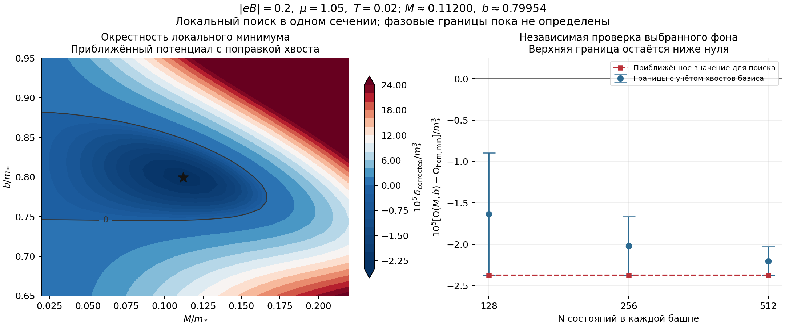

# 14. Уточнение локального минимума CDW

Дата: 2026-11-07. Продолжение [первого кандидата](13-adaptive-search-and-cdw-candidate.md), этап A8 [плана](00-plan.md).

**Результат:** в сечении $\mathcal B=|eB|=0.2$, $\mu=1.05$, $T=0.02$ численный локальный поиск даёт

$$
M\simeq0.1120,\qquad b\simeq0.79954.
$$

Положение найдено по приближённому потенциалу с аналитической поправкой первого вакуумного хвоста. Отдельная проверка полного потенциала в этой точке на $N=512$ даёт оценку

$$
-2.37258\cdot10^{-5}\ \lesssim\
\Omega(M,b)-\Omega_{\mathrm{hom,min}}
\ \lesssim\ -2.02962\cdot10^{-5}.
$$

Отрицательная верхняя граница подтверждает выигрыш конкретного неоднородного фона у численно проверенного однородного семейства. Положение **точного** минимума непрерывного потенциала этим интервалом не сертифицировано; глобальность среди всех $M,b$ также ещё не установлена. Все величины — в единицах $m_*=1$, $g=-\pi$, потенциал на единицу площади и на одну копию фермионов.

**Продолжение:** [заметка 15](15-continuation-and-zero-field-control.md) прослеживает кандидаты в двух сечениях по μ,B и независимо проверяет одинаковые фоны при B=0.

## 1. Сколько осталось до диаграммы

До первой обоснованной диаграммы при фиксированном $T=0.02$ выделяем пять этапов:

1. Уточнить найденный минимум по $M,b$ и проверить сходимость. В этой заметке выполнено локальное численное уточнение одного кандидата.
2. Проследить область выигрыша по $\mu,\mathcal B$, включая бесполевой контроль при тех же $\mu,T$.
3. Искать конкурирующие минимумы во всей выбранной области $0\le\mu\le3$, $0\le\mathcal B\le4$; контролировать область поиска по $M,b$ и пропущенные ветви.
4. Уточнить границы фаз и определить характер переходов по поведению конкурирующих минимумов.
5. Проверить итоговую карту на более точных расчётах и построить диаграмму с явно обозначенной неопределённостью.

Это этапы исследования, а не заранее известное число запусков. Для диаграммы при $T=0$ добавляется отдельная проверка снижения температуры. Локальное уточнение первого этапа не закрывает глобальную задачу третьего.

## 2. Как ищем минимум, не принимая ошибку базиса за выигрыш

Исходная разность конечного базиса сильно занижает цену модуляции. Для быстрого поиска используем

$$
\delta_{\mathrm{corr},N}(M,b)
=\Omega(M,0)-\Omega_{\mathrm{hom,min}}
+\Delta\Omega_N(M,b)
+P_{1,\mathrm{vac}}^\infty-P_{1,\mathrm{vac}}^N.
$$

Последняя разность — первый вакуумный хвост, выведенный в [заметке 12](12-basis-bounds-and-homogeneous.md). Поправка убирает ведущую ошибку, но не заменяет остальные вакуумные и тепловые границы. Поэтому $\delta_{\mathrm{corr},N}$ — **целевая функция поиска, а не верхняя граница полного потенциала**.

Конечная $\Delta\Omega_N$ для поиска вычисляется через собственные значения той же матрицы $L_N$. В финальной проверке она независимо пересчитывается суммой Мацубары по определителю Шура; затем добавляются обе границы ошибки базиса из [заметки 13](13-adaptive-search-and-cdw-candidate.md). Так поиск можно сделать быстрее, сохранив отдельную проверку выигрыша выбранного фона.

Область локального поиска: $0.01\le M\le0.3$, $0.6\le b\le1.0$. На $N=32$ используются три начальные точки: $(0.05,0.75)$, $(0.1,0.8)$ и $(0.2,0.9)$. Все сходятся в одну окрестность; границы локальной области не выбираются. Затем минимум уточняется при $N=64,128,256$. Дополнительная сетка из $25\times31$ точек отображает окрестность независимо от траектории оптимизатора.

## 3. Сходимость положения и значения

| $N$ в каждой башне | $M$ локального поиска | $b$ локального поиска | $\delta_{\rm corr,N}$ |
|---:|---:|---:|---:|
| 32 | 0.11202796 | 0.79952871 | $-2.37353944\cdot10^{-5}$ |
| 64 | 0.11200006 | 0.79953613 | $-2.37251808\cdot10^{-5}$ |
| 128 | 0.11199624 | 0.79953681 | $-2.37239488\cdot10^{-5}$ |
| 256 | 0.11199624 | 0.79953681 | $-2.37237749\cdot10^{-5}$ |

На базисах 64–256 масса меняется примерно на $4\cdot10^{-6}$, параметр $b$ — менее чем на $10^{-6}$; значение функции меняется менее чем на $2\cdot10^{-9}$. Это наблюдаемая численная сходимость, а не строгий интервал для координат точного минимума. Дополнительные цифры в таблице оставлены для воспроизводимости.

Численная матрица вторых производных $\delta_{\rm corr,256}$, проверенная шагами $10^{-3}$ и $5\cdot10^{-4}$, равна приблизительно

$$
\begin{pmatrix}
0.015122&0.007141\\
0.007141&0.018529
\end{pmatrix}.
$$

Её собственные значения $0.009484$ и $0.024167$ положительны и устойчивы к изменению шага. Это диагностирует локальный минимум целевой функции поиска. Для строгого утверждения о гессиане точного бесконечномерного потенциала потребовался бы отдельный контроль производных ошибки.

## 4. Полные оценки в одной и той же точке

Здесь во всех строках фиксированы $M=0.1119962401$, $b=0.7995368101$, а не заново подобранные координаты. Однородный минимум остаётся $M=0$ с $\Omega_{\rm hom,min}=-0.0616635895287$; повторены уточнение сетки и расширение области массы до 4 и 6.

| $N$ | Нижняя оценка $\delta$ | Верхняя оценка $\delta$ |
|---:|---:|---:|
| 128 | $-2.37259685\cdot10^{-5}$ | $-8.93566857\cdot10^{-6}$ |
| 256 | $-2.37257947\cdot10^{-5}$ | $-1.66609863\cdot10^{-5}$ |
| 512 | $-2.37257681\cdot10^{-5}$ | $-2.02961860\cdot10^{-5}$ |

Включён запас $2\cdot10^{-9}$ на однородное опорное значение и оценки частотного и осцилляторного хвостов. Различие прямой конечной спектральной суммы и суммы Мацубары не превышает $6\cdot10^{-13}$. Математические неравенства для хвостов реализованы обычной арифметикой с оценками квадратуры и округления; это не компьютерное доказательство в интервальной арифметике.

Улучшение значения по сравнению с исходной точкой $M=0.1,b=0.8$ видно по сходящейся целевой функции. Ширина строгих аналитических границ с численно оценёнными входными величинами пока больше этого улучшения, поэтому их одних недостаточно для строгого сравнения двух близких неоднородных фонов. Для вывода о выигрыше у однородного семейства отрицательной верхней границы достаточно в рамках указанных численных ограничений.

Левая панель показывает приближённый ландшафт; её нулевая линия не является установленной фазовой границей. Правая панель проверяет один фиксированный фон относительно однородного семейства.

## 5. Код и ближайшее продолжение

В `cdw-magnetic/code/`: `refine_cdw_candidate.py`, `plot_cdw_refinement.py`, отчёт `cdw-candidate-refinement.json`. В расчёт встроены проверки сходимости координат и значения, положительности диагностического гессиана, согласия конечных спектральных и частотных сумм и отрицательности верхних границ. Команды — в `code/README.md` исходного репозитория.

Следующий шаг — продолжать эту ветвь по $\mu$ и $\mathcal B$, сравнивая её с заново найденным однородным минимумом в каждой точке. Одновременно нужен контроль $B=0$ при тех же $\mu,T$. Пока нельзя переносить вывод одного сечения на всю плоскость параметров или объявлять поле причиной возникновения CDW без этого сравнения. Результаты сохранены локально; публикация не выполнялась.
