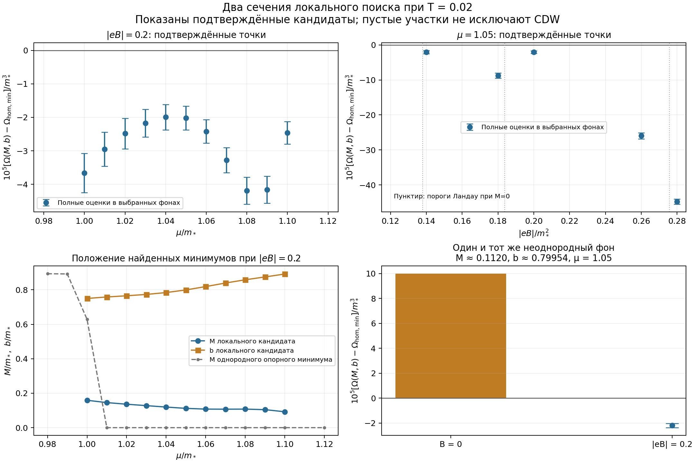

# 15. Продолжение кандидата и бесполевой контроль

Дата: 2026-11-07. Продолжение [локального уточнения](14-local-cdw-minimum.md), этап A8 [плана](00-plan.md).

**Результат:** при $T=0.02$, $g=-\pi$ выигрыш CDW подтверждён в 15 различных точках двух сечений $(\mu,\mathcal B)$, а не только в исходной точке. Здесь $\mathcal B=|eB|$. Одновременно независимо вычислен потенциал при $B=0$: исходный неоднородный фон при тех же $\mu,T$ там проигрывает однородному минимуму.

Это сечения локального поиска, а не полная фазовая диаграмма. Отрицательная верхняя оценка доказывает выигрыш выбранного фона в пределах оговорённого численного контроля. Неудача локального поиска не доказывает отсутствия других CDW-минимумов. Непрерывные промежутки между точками пока не классифицируются.

Единицы: $m_*=1$, $M,b,\mu,T$ в единицах $m_*$, $\mathcal B$ — $m_*^2$, потенциал — $m_*^3$ на единицу площади и одну копию фермионов.

**Продолжение:** в [заметке 16](16-preliminary-phase-map.md) построена предварительная карта из 500 узлов, включая 58 точек с проверенным выигрышем CDW.

## 1. Что изменилось в вычислении

В каждой точке $(\mu,\mathcal B)$ однородный минимум ищется заново: сетки из 81 и 141 исходных узлов, области массы до 4 и 6, дополнительные пороговые точки. Согласие значений проверяется до $10^{-9}$; в финальных оценках используется запас $2\cdot10^{-9}$ на опорное значение. Единственность однородного минимума не предполагается.

Локальная ветвь продолжается в обе стороны от исходной точки, используя предыдущий минимум и дополнительный старт. Целевая функция — полный конечный спектр с поправкой первого вакуумного хвоста из заметки 14. Поиск повторяется на $N=64,128$; затем выбранный фон проверяется определителем Шура и полными границами на $N=128,256$. При необходимости предусмотрен $N=512$.

Начальное окно поиска: $M\in[0,0.7]$, $b\in[0.2,1.5]$. Если кандидат не найден, добавляются старты $(0.3,0.65)$, $(0.3,0.9)$, $(0.55,0.6)$. В точке $\mu=0.98$, $\mathcal B=0.2$ поиск достиг верхней границы массы; окно расширено до $M\le1.4$ и $b\ge0$, после чего найден однородный конец $b=0$. Эти дополнительные старты не превращают поиск в глобальный.

На подтверждённых точках изменение координат при переходе от $N=64$ к 128 не превышает $8\cdot10^{-6}$ по массе и $3\cdot10^{-6}$ по $b$. Проверки полных границ относятся к фиксированным выбранным координатам; формального интервального контроля глобального минимума и округления нет.

## 2. Сечение по химическому потенциалу

При $\mathcal B=0.2$ проверены 14 значений $\mu$. Выигрыш подтверждается во всех 11 вычисленных точках $\mu=1.00,1.01,\ldots,1.10$. Это не доказательство знака во всём непрерывном интервале.

| $\mu$ | $M$ кандидата | $b$ кандидата | $10^5\delta_{\rm upper}$, N=256 | Статус поиска |
|---:|---:|---:|---:|---|
| 0.98 | — | — | — | Однородный конец b=0 |
| 0.99 | — | — | — | Без подтверждённого выигрыша |
| 1.00 | 0.158970 | 0.749981 | -3.07665 | Выигрыш подтверждён |
| 1.01 | 0.145445 | 0.758630 | -2.44431 | Выигрыш подтверждён |
| 1.02 | 0.136066 | 0.765584 | -2.02781 | Выигрыш подтверждён |
| 1.03 | 0.127811 | 0.773458 | -1.75769 | Выигрыш подтверждён |
| 1.04 | 0.119525 | 0.784269 | -1.61198 | Выигрыш подтверждён |
| 1.05 | 0.111996 | 0.799537 | -1.66609 | Выигрыш подтверждён |
| 1.06 | 0.107657 | 0.818957 | -2.06945 | Выигрыш подтверждён |
| 1.07 | 0.107225 | 0.839657 | -2.89858 | Выигрыш подтверждён |
| 1.08 | 0.107651 | 0.858489 | -3.78128 | Выигрыш подтверждён |
| 1.09 | 0.104461 | 0.874984 | -3.75366 | Выигрыш подтверждён |
| 1.10 | 0.092210 | 0.891891 | -2.12333 | Выигрыш подтверждён |
| 1.12 | — | — | — | Возврат к M=0 |

В строках без подтверждения верхняя оценка не приводится: отрицательного перспективного значения целевой функции не найдено, и отдельная дорогая проверка полного потенциала для этих локальных исходов не запускалась. При $M=0$ волновое число физически несущественно.

При $\mu=1.00$ однородный опорный минимум имеет $M_{\rm hom}\simeq0.62872$, а неоднородный кандидат — $M\simeq0.15897$, $b\simeq0.74998$. Это подчёркивает необходимость сравнивать с минимумом по всей однородной массе, а не с однородным фоном той же амплитуды.

## 3. Сечение по полю

При $\mu=1.05$ проверено 9 значений поля. Подтверждённые точки:

| $\mathcal B$ | $M$ кандидата | $b$ кандидата | $10^5\delta_{\rm upper}$, N=256 | Статус поиска |
|---:|---:|---:|---:|---|
| 0.12 | — | — | — | Возврат к M=0 |
| 0.14 | 0.095345 | 0.869278 | -1.54080 | Выигрыш подтверждён |
| 0.16 | — | — | — | Возврат к M=0 |
| 0.18 | 0.144771 | 0.826002 | -8.00722 | Выигрыш подтверждён |
| 0.20 | 0.111996 | 0.799537 | -1.66609 | Выигрыш подтверждён |
| 0.22 | — | — | — | Возврат к M=0 |
| 0.24 | — | — | — | Возврат к M=0 |
| 0.26 | 0.230436 | 0.735369 | -25.08194 | Выигрыш подтверждён |
| 0.28 | 0.218172 | 0.746759 | -44.02055 | Выигрыш подтверждён |

При $\mathcal B=0.12,0.16,0.22,0.24$ поиск вернулся к $M=0$, включая дополнительные старты. Это отсутствие найденного кандидата в данном поиске, а не установленная однородная фаза. Также нельзя пока объявлять CDW-область связной или разбитой на острова.

Для ориентира, пороги заполнения однородного **безмассового** спектра удовлетворяют $\mu^2=2n\mathcal B$. При $\mu=1.05$ это $\mathcal B=0.275625,0.18375,0.1378125$ для $n=2,3,4$. Их близость к некоторым найденным кандидатам мотивирует дальнейшую проверку связи с заполнением уровней Ландау; причинный механизм этим совпадением не установлен. При ненулевой однородной массе пороги сдвигаются.

## 4. Независимый потенциал при B=0

Бесполевой контроль вычисляется непосредственно по дисперсии

$$
E_\pm^2=p_y^2+\left(\sqrt{p_x^2+M^2}\pm b\right)^2,
$$

а не малым значением поля в обрезанном осцилляторном базисе. Это позволяет избежать роста числа необходимых уровней при $B\to0$.

### Аналитический вакуумный вклад

В физической регуляризации с вычитанием фона $M=0$ и перенормировкой из заметки 04 интегрирование по $p_y$ даёт для производной вакуумного потенциала

$$
\frac{\partial^2 V}{\partial b^2}
=\frac{1}{\pi^2}\int_0^\infty dx\,
\ln\left|\frac{x^2+M^2-b^2}{x^2-b^2}\right|
=\frac{\sqrt{M^2-b^2}}{\pi}\,\theta(M-b).
$$

Логарифмические особенности интегрируемы. Используем $V(M,0)=M^2/(2g)+M^3/(3\pi)$ и $\partial_bV(M,0)=0$. После двух интегрирований получаем

$$
V(M,b)=\frac{M^2}{2g}+
\begin{cases}
\displaystyle\frac{(2M^2+b^2)\sqrt{M^2-b^2}
+3M^2b\arcsin(b/M)}{6\pi},&0\le b<M,\\[6pt]
\displaystyle\frac{M^2b}{4},&b\ge M.
\end{cases}
$$

При $M=0$ это ноль независимо от $b$. Нормировка согласована с однородным вакуумом; это удобная аналитическая форма бесполевого вакуумного интеграла, соответствующего (40)–(43) [CDW], обозначения статьи — в [постановке](../README.md).

### Среда и конечная температура

При $T=0$ интеграл по $p_y$ выполняется точно:

$$
J(a,\nu)=\int_0^\infty dy\,(\nu-\sqrt{y^2+a^2})_+
=\frac12\left[\nu\sqrt{\nu^2-a^2}
-a^2\operatorname{arcosh}\frac{\nu}{|a|}\right]\theta(\nu-|a|),
$$

с пределом $J(0,\nu)=\nu^2/2$. Тогда

$$
W_0(M,b;\nu)=-\frac1{\pi^2}\int_0^\infty dx\,
\left[J(\sqrt{x^2+M^2}+b,\nu)+J(\sqrt{x^2+M^2}-b,\nu)\right].
$$

Обе области интегрирования конечны и известны из условия $|\sqrt{x^2+M^2}\pm b|<\nu$.

Температура вводится точным свёрточным тождеством, включающим частицы и античастицы:

$$
W_T(M,b;\mu)=\int_0^\infty d\nu\ K_T(\nu;\mu)W_0(M,b;\nu),
$$

$$
K_T=\frac1{4T}\left[
\operatorname{sech}^2\frac{\nu-\mu}{2T}
+\operatorname{sech}^2\frac{\nu+\mu}{2T}\right].
$$

Оно следует из двукратного интегрирования температурного веса: $H_{T,\mu}(E)=\int_E^\infty d\nu\,K_T(\nu;\mu)(\nu-E)$. Потенциал равен $V+W_T$. В коде свёртка обрезается выше $\mu+36T$ с аналитической оценкой хвоста: $|W_0|\le\nu(\nu+b)^2/(2\pi)$ и $K_T\le T^{-1}e^{(\mu-\nu)/T}(1+e^{-2\mu/T})$. При необходимости граница увеличивается.

Независимые проверки:

- $b=0$: согласие с отдельной реализацией однородного потенциала при $T=0$ и $T>0$.
- $M=0$: независимость от $b$.
- При $T=0$, $\nu>M+b$: воспроизводится $\Omega=M^2/(2g)+\nu M^2/(2\pi)-\nu^3/(6\pi)$.
- Аналитический вакуум сравнивается с независимо вычтенным двумерным импульсным интегралом в случаях $b<M$, $b=M$, $b>M$; остаток после ведущей УФ-поправки убывает примерно в восемь раз при удвоении обрезания.
- Температурная свёртка сравнивается с прямым двумерным полярным интегралом; расхождения в трёх проверках меньше $2\cdot10^{-14}$, в пределах оценок квадратуры.

## 5. Что показывает бесполевой контроль

При $\mu=1.05$, $T=0.02$ однородный минимум при $B=0$ имеет $M=0$; поиск проверен на сетках 141 и 401 и областях массы до 4 и 6. Для одного и того же фона $M=0.1119962401$, $b=0.7995368101$:

$$
\delta_{B=0}=+9.98336\cdot10^{-5},
\qquad \text{оценка квадратуры }2.6\cdot10^{-11},
$$

тогда как при $\mathcal B=0.2$ оценка из заметки 14 на $N=512$ даёт

$$
\delta_{\mathcal B=0.2}\in
[-2.37258,-2.02962]\cdot10^{-5}.
$$

Поле меняет предпочтительность **данного** неоднородного фона относительно соответствующих однородных минимумов. Проверены также бесполевые фоны $(M,b)=(0.1,0.8),(0.05,0.8),(0.2,0.8)$ — они проигрывают. Это ещё не независимое глобальное исключение всех CDW-состояний при $B=0,T=0.02$.

На верхних панелях показаны только фоны с отрицательными полными верхними оценками; пустые участки не означают отсутствия CDW. Линии между координатами локальных минимумов на нижней левой панели служат ориентиром по вычисленным точкам.

## 6. Воспроизведение и следующий этап

В `cdw-magnetic/code/`: `zero_field_potential.py`, `check_zero_field_potential.py`, `continue_cdw_branch.py`, `plot_cdw_continuation.py`. Отчёты: `zero-field-potential-checks.json`, `cdw-branch-continuation.json`; команды — в `code/README.md` исходного репозитория. Все изменения локальные, публикация не выполнялась.

Из второго этапа дорожной карты заметки 14 выполнены два пробных сечения и бесполевой контроль одинаковых фонов. Нужны двумерный поиск конкурирующих минимумов, более широкий бесполевой поиск и уточнение переходных областей. Особенно важно проверить, что происходит между найденными точками по полю: локальное исчезновение одной ветви не исключает появления другой. Фазовые границы и их порядок пока не определены; контроль снижения температуры остаётся отдельной работой.
