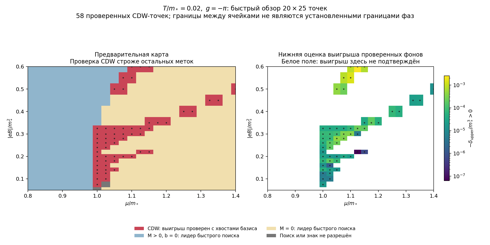
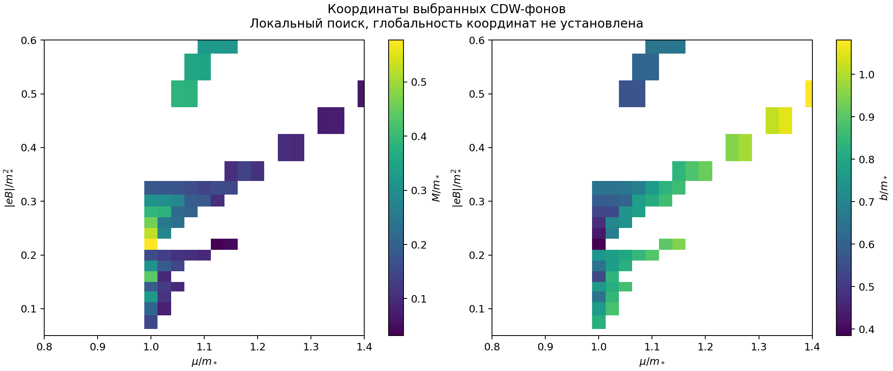

# 16. Первая предварительная карта фаз

Дата: 2026-11-07. Ветка A, ведущий порядок $1/N$, CDW-анзац. Продолжение [двух сечений](15-continuation-and-zero-field-control.md).

**Практический результат:** построена обзорная карта из 500 точек при $T=0.02$, $g=-\pi$ в области

$$
0.8\le\mu\le1.4,\qquad 0.05\le\mathcal B=|eB|\le0.6.
$$

В **58 точках** найден неоднородный фон, который выигрывает у численно найденного однородного минимума после отдельного учёта хвостов базиса. Картина содержит несколько полос и участков выигрыша CDW. Это положительный ответ на вопрос, есть ли смысл продолжать исследование. Точные границы и глобальные координаты минимумов ещё не установлены.

Единицы: $m_*=1$; массы, волновые параметры, химпотенциал и температура измеряются в $m_*$, поле — в $m_*^2$, потенциал на единицу площади и одну копию фермионов — в $m_*^3$.

## 1. Что именно показывает карта

| Метка | Число узлов | Смысл |
|---|---:|---|
| CDW, красный | 58 | Выбранный фон с M>0,b>0 имеет отрицательную полную верхнюю оценку относительно однородного опорного минимума; проверены минимум два размера базиса |
| Однородный M>0, синий | 173 | Лидер приближённого быстрого поиска, без глобального исключения других CDW-минимумов |
| M=0, светлый | 267 | Лидер приближённого быстрого поиска, без глобального исключения других CDW-минимумов |
| Неопределённо, серый | 2 | Перспективное значение найдено, но проверка знака не завершилась согласованной конечной верхней границей |

**Разный уровень проверки принципиален:** синий и светлый цвета не доказывают отсутствия CDW. Серый выделяет две дополнительные технически неразрешённые точки, но остальные 440 некрасных узлов тоже имеют предварительную классификацию. При M=0 параметр b несущественен.

Каждая окрашенная ячейка визуализирует один вычисленный узел. Между узлами потенциал не классифицирован; ступенчатые края ячеек не являются установленными границами фаз. Полевая сетка неравномерна и уплотнена в ранее исследованной области; она содержит 20 значений. Сетка химпотенциала содержит 25 значений с шагом 0.025.

На правой панели показано $-\delta_{\rm upper}>0$: нижняя оценка выигрыша выбранного фона, где $\delta=\Omega(M,b)-\Omega_{\rm hom,min}$. Белое поле означает отсутствие подтверждённого выигрыша в данном поиске.

## 2. Как удалось быстро получить обзор

Для каждого поля один раз подготовлен набор из 242 спектров на базисе N=64: 11 масс и 22 значения b. Все 25 значений химпотенциала затем используют эти же спектры:

$$
\Omega(M,b;\mu,B,T)=\Omega_{\rm vac}(M,b;B)
-d_B\sum_k H_{T,\mu}(E_k),\qquad E_k=E_k(M,b,B).
$$

Таким образом, первоначальный спектральный обзор требует 4840 диагонализаций, а не 121000 отдельных вычислений для всех μ на той же сетке. Это уменьшение числа операций именно на этапе общего спектрального набора, а не измеренное ускорение всей программы в 25 раз.

Для быстрого поиска добавляется аналитическая поправка первого вакуумного хвоста из заметок 12–14. Пропущенный однородный тепловой хвост при N=64 во всей выбранной сетке меньше $1.5\cdot10^{-28}$; в финальной проверке он учитывается общей формулой. Вакуум и общий массовый набор однородного сравнения также переиспользуются между μ.

В каждой точке запускаются локальные уточнения из разных спектральных кандидатов, предыдущей перспективной точки по μ и, при ненулевой однородной массе, малого b возле однородного фона. Локальная область $0\le M\le1.6$, $0\le b\le1.7$ конечна; общий глобальный поиск этим не заменяется. Рабочая точность решений о лидере быстрого поиска — $10^{-7}$ по потенциалу.

Перспективные неоднородные точки уточняются на N=128 и сравниваются с независимым более плотным однородным поиском, включающим пороги заполнения и область массы до 6. Затем отдельно вычисляются границы полного потенциала через определитель Шура, вакуумный хвост и тепловой спектр. Проверяются N=128,256, при необходимости 512. Из 58 подтверждённых узлов 55 прошли на последнем базисе 256, ещё 3 потребовали 512. Включён запас $2\cdot10^{-9}$ на однородное опорное значение.

Строки разных полей вычисляются в четырёх отдельных CPU-процессах; контрольный файл сохраняется после каждой строки и поддерживает продолжение. Физическое приближение от такого распараллеливания не меняется.

## 3. Что видно в найденных фонах

Это координаты найденных локальных фонов, а не сертифицированные координаты глобального минимума. В подтверждённых точках M лежит примерно между 0.0318 и 0.5773, а b — между 0.3849 и 1.0806.

При $\mathcal B=0.2$ прежний результат воспроизведён в узлах $\mu=1.00,1.025,1.05,1.075,1.10$. В других полях выигрыш встречается также при больших μ. Например, сильный найденный фон:

$$
\mathcal B=0.6,\quad\mu=1.125,\quad
M\simeq0.32652,\quad b\simeq0.65408.
$$

Дополнительная проверка на N=512 даёт

$$
\delta\in[-0.00255193,-0.00254679].
$$

Здесь выигрыш значительно больше ошибок хвоста. На противоположном конце точности есть слабая точка $\mathcal B=0.22,\mu=1.125$ с верхней оценкой порядка $-6.3\cdot10^{-8}$; она требует осторожности при последующем уточнении границ. Численно найденная структура мотивирует исследование заполнения уровней Ландау, но одна обзорная карта не устанавливает механизм или число отдельных фаз.

## 4. Проверки и два неразрешённых узла

Проверены:

- согласие переиспользуемого спектрального набора с прежним независимым вычислением потенциала для девяти сочетаний фонов и μ;
- воспроизведение прежних подтверждённых кандидатов, попадающих на новую сетку;
- согласие прямого конечного спектра с частотной суммой в каждой подтверждённой точке;
- пересечение интервалов разных размеров базиса;
- отдельные повторные расчёты сильной, слабой, исходной и промежуточной точек на N=512 с однородной сеткой 401 и областью массы до 8.

Два серых узла: $(\mathcal B,\mu)=(0.05,1.00)$ и $(0.075,1.025)$. В первоначальной проверке возникло численное нарушение порядка тепловых границ у почти нулевых собственных значений. Эти результаты не использовались для подтверждения фазы. Повторные расчёты на больших базисах сохранены отдельно:

- В первой точке на N=256 и 512 оценка вычисляется, но её верхняя граница ещё не устанавливает отрицательный знак.
- Во второй на N=256 верхняя вакуумная оценка недоступна, а на 512 повторяется численная несогласованность тепловых границ. Она остаётся неопределённой.

Аналитические неравенства реализованы обычной арифметикой с оценками квадратуры и численной погрешности. Строгого компьютерного доказательства в интервальной арифметике, полноты поиска и непрерывных границ здесь нет.

## 5. Что делать после этой карты

Первая практическая цель достигнута: получен быстрый обзор и обнаружены участки с проверенным выигрышем CDW. Теперь выгоднее сосредоточиться на нескольких характерных участках, чем сразу увеличивать точность всех 500 узлов:

1. Проверить конкурирующие минимумы и расширение окна M,b вокруг сильного участка при полях 0.5–0.6 и около исходной полосы при 0.2–0.325.
2. Сгустить сетку по μ,B на переходах между лидерами; искать минимум также с противоположных сторон границы и сохранять несколько ветвей.
3. Повторить выбранные сечения при T=0.01, чтобы отделить устойчивые области от температурно чувствительных участков.

Сравнение одинакового фона с B=0 уже выполнено в [заметке 15](15-continuation-and-zero-field-control.md); глобальный бесполевой поиск остаётся отдельной проверкой. Порядок переходов и предел T→0 пока не определены.

Код в `cdw-magnetic/code/`: `phase_scout.py`, `check_phase_scout.py`, `plot_phase_scout.py`. Данные — `phase-scout.json`, `phase-scout-audit.json`; команды — в `code/README.md` исходного репозитория. Результаты сохранены локально, публикация на GitHub Pages не выполнялась.
