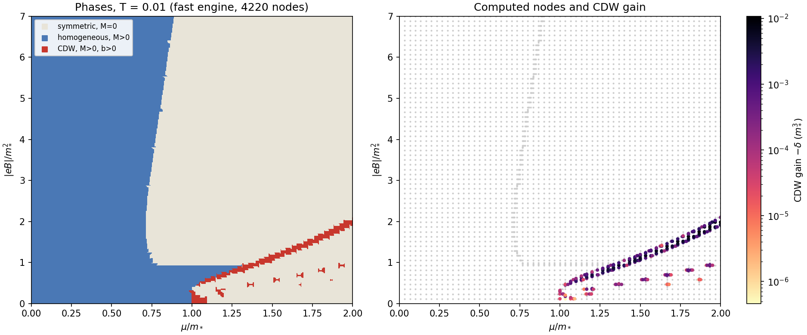
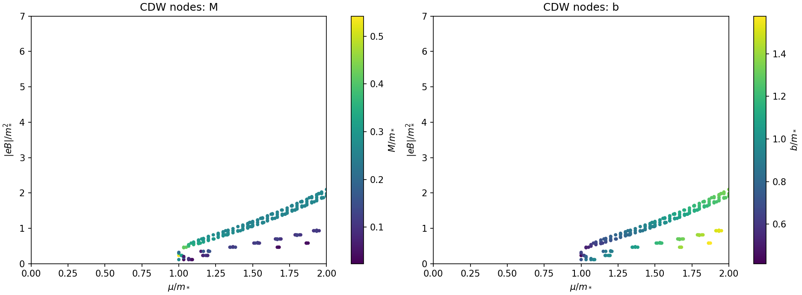

# 18. Адаптивная карта фаз при T = 0.01

Дата: 2026-11-07. Ветка A, этап A8 [плана](00-plan.md). Движок — [заметка 17](17-fast-engine.md). Код — `code/adaptive_map.py`, `code/plot_adaptive_map.py`, данные — `code/adaptive-map.json`.

**Результат:** карта в области $0<\mu\le2$, $0<|eB|\le7$ при $T=0.01$, $g=-\pi$ ($m_*=1$): 4220 узлов за 221 с на 4 ядрах. CDW найдена в 218 узлах. Все они лежат около **порогов заполнения уровней Ландау** $\mu^2\approx2n|eB|$, $n=1,2,3,\dots$. Самая широкая и сильная полоса — у первого порога $n=1$, выигрыш там доходит до $10^{-2}\,m_*^3$.

Карта не сертифицирована: каждый CDW-узел подтверждён прямым расчётом без сплайна на двух размерах базиса, но строгих границ `relative_interval` нет. Однородные метки означают лидера глобального поиска на сетке $(M,b)$.

## 1. Как считалось

- **Грубая сетка** 60×60: $\mu_k=2k/60$, $|eB|_j=7j/60$, $k,j=1\dots60$.
- **Уточнение делением рёбер.** Если у двух соседних узлов (по $\mu$ или по $B$) разные метки, считается средний узел. Три уровня, так что шаг около границ уменьшается в 8 раз: до $0.004$ по $\mu$ и $0.015$ по $|eB|$.
- **В каждом узле** — глобальный поиск по сетке $M\in[0,2]$, $b\in[0,b_{\max}]$ с шагом 0.05 и локальное уточнение. $b_{\max}=\min(2,\sqrt{30|eB|})$, так что базис вакуума не превышает 512. Ни один CDW-минимум не упёрся в границу по $b$.
- **Метки:**
  - **CDW** — отрицательный выигрыш, подтверждённый прямым расчётом;
  - **однородная** — однородный минимум с $M>10^{-4}$;
  - **симметричная** — $M=0$.

| Этап | Новых узлов | Строк $B$ | Время с начала |
|---|---:|---:|---:|
| Грубая сетка | 3600 | 60 | 55 с |
| Уточнение 1 | 206 | 83 | 93 с |
| Уточнение 2 | 207 | 98 | 151 с |
| Уточнение 3 | 207 | 108 | 221 с |

Итог: 2420 симметричных, 1582 однородных и 218 CDW-узлов.

## 2. Карта

Слева фаза в каждой точке раскрашена по ближайшему посчитанному узлу, справа показаны сами узлы и величина выигрыша CDW. Видно:

- **Однородная фаза** ($M>0$) занимает область $\mu\lesssim0.75$–$0.9$. С ростом поля её граница сдвигается к большим $\mu$ (магнитный катализ).
- **Симметричная фаза** — при больших $\mu$.
- **CDW** образует полосу от $(\mu,|eB|)\approx(1.0,0.4)$ до $(2.0,2.0)$ и ряд островков при меньших полях.

В CDW-узлах $M\approx0.02$–$0.54$, $b\approx0.41$–$1.58$. В основной полосе $M\approx0.3$, а $b$ растёт с $\mu$ от $\approx0.6$ до $\approx1.4$.

## 3. Связь с уровнями Ландау

Фактор заполнения безмассового спектра $\nu=\mu^2/(2|eB|)$ в CDW-узлах:

| Группа | Узлов | $\nu$ |
|---|---:|---|
| Основная полоса | 160 | $0.93\ldots1.18$, медиана 1.03 |
| Островки у $n=2$ | ≈35 | $1.94\ldots2.06$ |
| Островки у $n=3$ | ≈12 | $2.97\ldots3.06$ |
| Отдельные узлы | 11 | 1.56–1.89, 2.1–2.6, 3.9, 4.3–5.1 |

CDW появляется, когда $\mu$ проходит порог заполнения очередного уровня Ландау безмассового спектра. Это картина типа де Гааза–ван Альфена. Она согласуется с наблюдением [заметки 15](15-continuation-and-zero-field-control.md) о близости кандидатов к порогам. Причинный механизм эта корреляция не доказывает: при $M\ne0$ пороги сдвигаются, а у CDW-фона с $b>M$ спектр устроен иначе.

Узлы карты [заметки 16](16-preliminary-phase-map.md) (при $T=0.02$) попадают в ту же основную полосу и островки.

## 4. Ограничения

- **Не сертифицировано.** Для отчётных точек нужны границы `relative_interval`, как в заметке 16.
- **Узкие островки могут быть пропущены.** Уточнение срабатывает только там, где у соседних узлов разные метки. Островок, который целиком помещается между узлами грубой сетки (шаг 0.033 по $\mu$, 0.117 по $|eB|$), не будет найден. Это особенно вероятно у высоких порогов $n\ge4$ в слабом поле, где островки узкие и частые.
- **Слабое поле.** Нижняя строка — $|eB|=0.117$. Область $|eB|<0.117$ не посчитана. При $|eB|\lesssim0.13$ ограничение $b\le\sqrt{30|eB|}$ строже, чем $b\le2$.
- **Растровая раскраска** по ближайшему узлу даёт ступенчатые края. Они не являются найденными границами.
- **$T=0.01$**; предел $T\to0$ здесь не исследуется.

## 5. Что дальше

1. Проверить несколько CDW-узлов строгими границами (основная полоса, островки $n=2,3$).
2. Сгустить сетку около порогов $\mu^2=2n|eB|$, $n\ge2$: там вероятны пропущенные островки. Это можно делать целенаправленно, а не равномерной сеткой.
3. Расширить область по $\mu$ ($b$ до $\mu$): дороже, особенно в слабом поле ([заметка 17](17-fast-engine.md)).
4. Сверить с веткой B: знак $D(q)$ при $q\approx2b$ около порогов.
