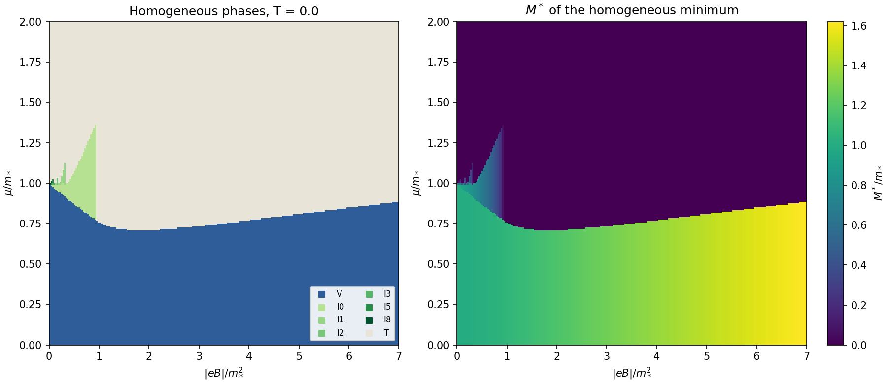
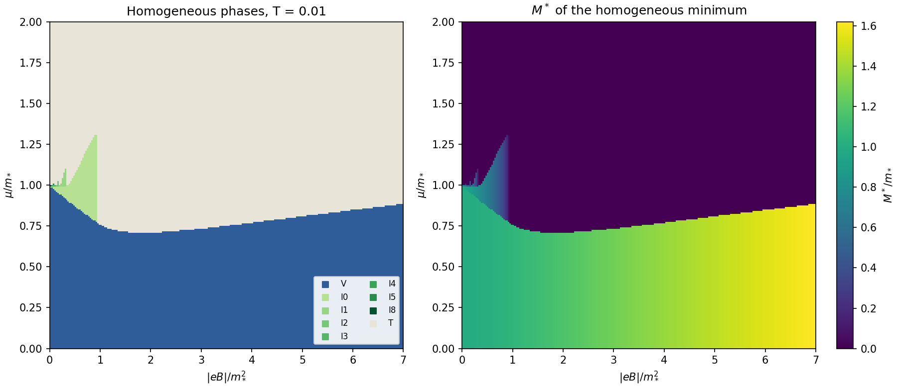

# 19. Однородная задача: формулы, сертифицированный минимум, диаграммы

Дата: 2026-11-07. Этапы Ф1, А1, Д1–Д2 [дорожной карты](../ROADMAP.md). Код — пакет `magcdw.hom` (`formulas.py`, `minimize.py`), тесты — `tests/test_hom.py`, диаграммы — `code/hom_diagram.py`.

**Результат:** однородный TDP в поле для одного мультиплета при любой $T\ge0$ реализован в замкнутом виде, без `mpmath`. Найдено регулярное разложение функции щели на монотонные части. На нём построен сертифицированный поиск **всех** экстремумов $\Omega(M)$ — по образцу `njl3.b0` из работы без поля. Он в 54 раза быстрее прежнего сеточного поиска и никогда не даёт худшего минимума. Построены диаграммы $(\mu,|eB|)$ при $T=0$ и $T=0.01$ по 57 600 точек, примерно по минуте на 4 ядрах.

Единицы: $m_*=\pi/|g|=1$; $B\equiv|eB|>0$, $d_B=B/2\pi$.

## 1. Потенциал

$$
\Omega(M)=\frac{M^2}{2g}+\frac{MB}{2\pi}-\frac{(2B)^{3/2}}{2\pi}\,\zeta\!\Big(-\tfrac12,\frac{M^2}{2B}\Big)
-d_B\sum_{n\ge0}s_n\,H_{T,\mu}(\varepsilon_n),
\qquad \varepsilon_n=\sqrt{M^2+2nB},
$$

$s_0=1$, $s_{n\ge1}=2$, $H_{T,\mu}(E)=T\ln(1+e^{-(E-\mu)/T})+T\ln(1+e^{-(E+\mu)/T})$, при $T=0$ — $(|\mu|-E)_+$. При $B\to0$ вакуумная часть переходит в (27) [CDW]: $M^2/2g+M^3/3\pi$.

Обобщённая дзета-функция Гурвица $\zeta(s,x)$ считается векторно по формуле Эйлера–Маклорена: 12 прямых слагаемых и 10 бернуллиевых поправок, точность $\sim10^{-13}$ относительно `mpmath`. $10^5$ значений — за 5 мс.

## 2. Функция щели и её монотонное разложение

$G(M)=\Omega'(M)/M$. С $w(E)=n_F(E-\mu)+n_F(E+\mu)$ (при $T=0$ — $\theta(|\mu|-E)$) и $x=M^2/2B$:

$$
G=\underbrace{\frac1g-\frac{\sqrt{2B}}{2\pi}\,\zeta\!\big(\tfrac12,x+1\big)}_{A(M)}
\;-\;d_B\,\frac{u(M)}{M}
\;+\;\underbrace{d_B\sum_{n\ge1}\frac{2\,w(\varepsilon_n)}{\varepsilon_n}}_{D(M)},
\qquad u=1-w(M).
$$

Здесь сингулярности $\pm B/2\pi M$ вакуума и нижнего уровня Ландау уже сокращены: $\zeta(\tfrac12,x)=x^{-1/2}+\zeta(\tfrac12,x+1)$.

- $A$ возрастает, потому что $\zeta(\tfrac12,\cdot)$ убывает. Она регулярна при $M\to0$.
- $u\in[0,1]$ не убывает, потому что $w$ не возрастает по $E$.
- $D$ не возрастает: $w(\varepsilon)/\varepsilon$ убывает по $\varepsilon$, а $\varepsilon_n$ растёт по $M$.

Отсюда на любом $[p,q]$, $0<p<q$:

$$
A(p)-d_B\frac{u(q)}{p}+D(q)\;\le\;G(M)\;\le\;A(q)-d_B\frac{u(p)}{q}+D(p).
$$

**Предел $M\to0$.** $G(0^+)=1/g-\tfrac{\sqrt{2B}}{2\pi}\zeta(\tfrac12,1)+d_B\,w'(0)+D(0)$ конечен при $T>0$ и при $T=0$, $\mu>0$. При $T=0$, $\mu=0$ вклад $-d_B/M\to-\infty$: $M=0$ никогда не минимум. Это магнитный катализ.

**Скачки при $T=0$.** Когда уровень $n$ пересекает $\mu$, $D$ скачком уменьшается. $\Omega'=MG$ при этом тоже падает, поэтому скачок может дать только излом-максимум $\Omega$, но не минимум. Минимумы — смены знака непрерывной $G$ с минуса на плюс.

## 3. Сертифицированный поиск

- Интервалы, на которых оценки раздела 2 одного знака, отбрасываются; остальные делятся пополам до ширины $10^{-10}$.
- Смена знака $-\to+$ уточняется методом Брента: это минимум. Смена $+\to-$ — максимум (или излом).
- Верхняя граница $M_{\max}$ выбирается так, что $A(M_{\max})-d_B/M_{\max}>0$; выше неё $G>0$.
- Глобальный минимум выбирается среди найденных минимумов и $M=0$.

Метки фаз — по заполнению уровней в минимуме, как V / Iⱼ / T в задаче $(\mu,L)$:
- **T** — $M^*=0$;
- **V** — $M^*>0$ и нет уровней ниже $\mu$;
- **Iⱼ** — $M^*>0$ и уровни $n=0\dots j$ ниже $\mu$.

## 4. Проверки (`tests/test_hom.py`, 14 тестов)

- $\zeta(s,x)$ против `mpmath` при $s=-\tfrac12,\tfrac12,\tfrac32$: относительная ошибка $<10^{-12}$.
- Вакуум против `mpmath` (30 знаков): $<10^{-12}$. Предел $B\to0$ — до $10^{-6}$ при $B=10^{-6}$.
- Потенциал против прежней реализации `code/homogeneous_potential.py` при $T=0$ и $T=0.01$: $<10^{-11}$.
- $G$ против конечных разностей $\Omega$ при $T=0.001,0.01,0.1$: $<10^{-6}$ относительно.
- Оценки раздела 2 охватывают $G$ на 200 точках каждого интервала при $T=0,0.001,0.01$.
- Минимум никогда не хуже сеточного поиска (401 узел, $M\le6$) с запасом $10^{-10}$. На 40 случайных точках разница не больше $3.5\cdot10^{-14}$, время — 4.4 мс против 239 мс.
- При $\mu=0$: $M^*\approx1$ в слабом поле и растёт с $B$ (магнитный катализ).

## 5. Диаграммы

Сетка 240×240, $0<\mu\le2$, $0<|eB|\le7$; при $T=0$ — 69 с, при $T=0.01$ — 80 с на 4 ядрах.

- **V** — нижняя область. $M^*$ растёт с полем от $\approx1$ до $\approx1.6$. Граница с T проходит при $\mu\approx0.7$–$0.9$ и имеет минимум около $|eB|\approx2$.
- **I₀** — клин при $|eB|\lesssim0.95$, $\mu\approx0.8$–$1.35$: заполнен только нижний уровень Ландау, $M^*\approx0.3$–$0.8$.
- **Каскад I₁, I₂, …** — тонкие пики у $\mu\approx1$ в слабом поле. Это аналог пиков $\mu_n=2\pi n/L$ задачи $(\mu,L)$. На сетке 240×240 они разрешены плохо, нужны укрупнения.
- **T** — остальное. При $T=0.01$ картина почти та же, самые тонкие пики сглажены.

Эти однородные минимумы — опорные состояния для неоднородной карты [заметки 18](18-adaptive-map.md). CDW появляется возле границ V/I₀/T и у порогов заполнения.

## 6. Что дальше по однородной задаче

1. **Точные линии переходов** (I и II рода) и особые точки — как `njl3.b0.lines`.
2. **Укрупнение каскада пиков** у $\mu\approx1$, $|eB|\to0$; асимптотика пиков.
3. **Предел $B\to0$**: сверка с задачей $(\mu,L)$ при $L\to\infty$. При $B=0$, $T=0$ переход при $\mu=1$, потенциал там плоский.
