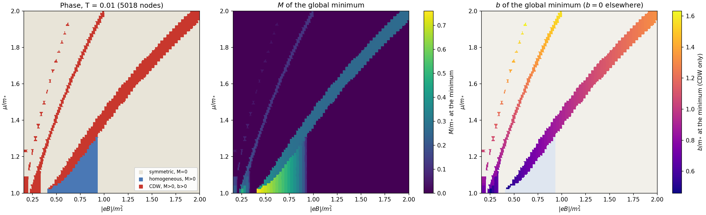
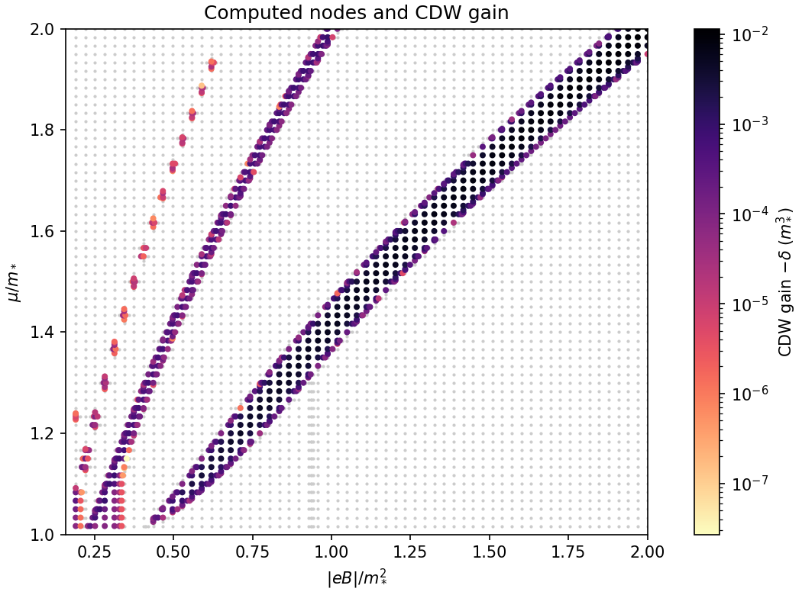
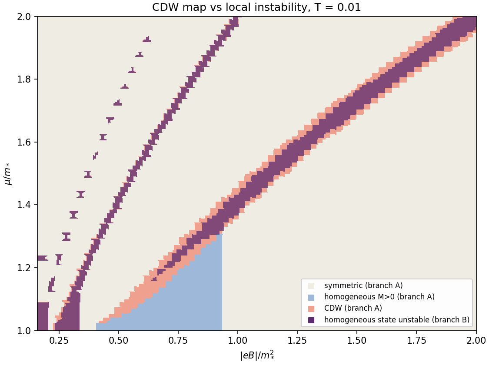
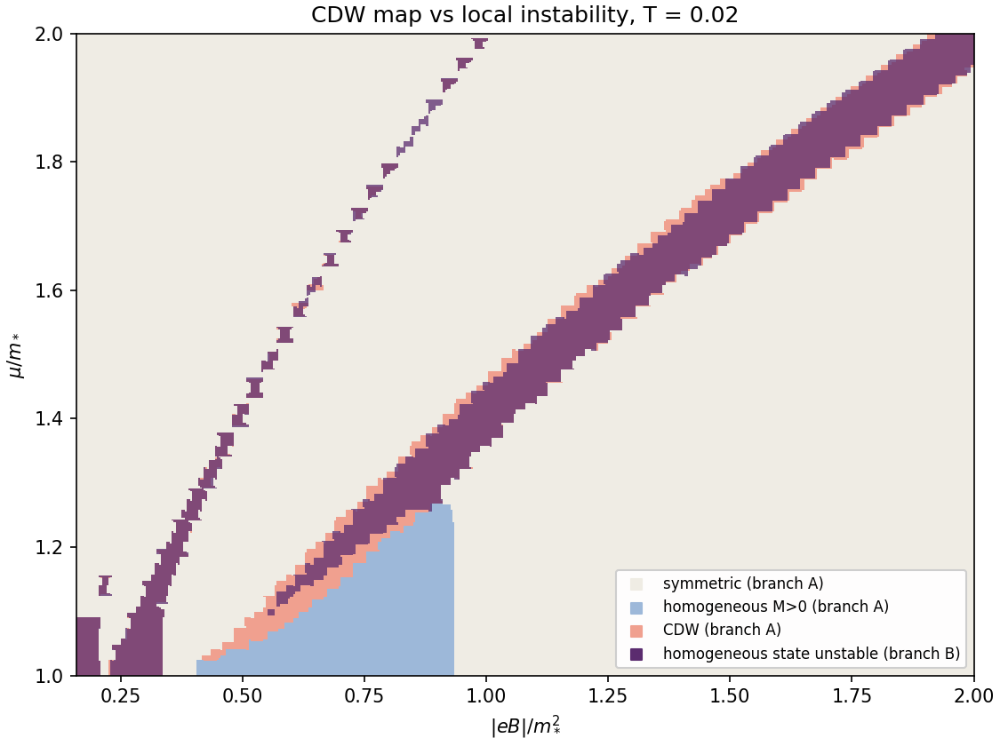
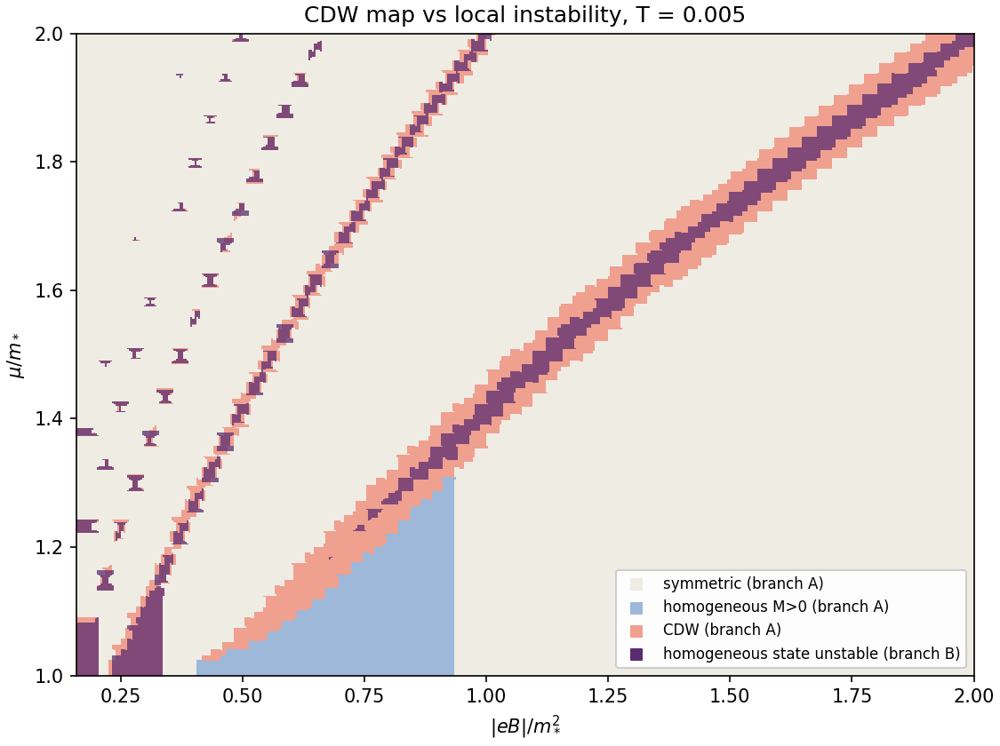

# 20. Неоднородная карта в области $1<\mu\le2$, $0.16\le eB\le2$, сверка с устойчивостью и зависимость от $T$

Дата: 2026-11-08. Ветка A, этапы Н1/Н3 [дорожной карты](../ROADMAP.md). Метод — [заметки 17](17-fast-engine.md), [18](18-adaptive-map.md); сравнение — с адаптивной картой устойчивости [B6](stability/06-maps.md). Код — `code/inh_adaptive_map.py`, `code/plot_adaptive_map.py`, `code/plot_inh_vs_stab.py`; данные — `code/inh-adaptive-map.json`.

**Результат:** CDW образует две **сплошные** полосы у порогов заполнения уровней Ландау $n=1$ и $n=2$, островки у $n=3$ и отдельные точки у $n=4$. Полоса $n=2$, на прежней грубой карте выглядевшая островками, подтверждена — её предсказал анализ устойчивости. Две независимые ветки согласуются: из 873 узлов, где однородное состояние локально неустойчиво, **867 (99.3%)** ветка A относит к CDW. Обратное не так: около половины CDW-узлов лежат там, где однородное состояние локально устойчиво, — это переходы первого рода. Раздел 5 — та же пара карт при $T=0.02$ и $T=0.005$: основная полоса от температуры почти не зависит, высокие пороги проявляются при охлаждении, доля переходов первого рода растёт (36% → 69%).

## 1. Как считалось

- Область $1<\mu\le2$, $0.16\le eB\le2$, $T=0.01$, $g=-\pi$ ($m_*=1$) — та же, что у адаптивной карты устойчивости.
- Грубая сетка 60×60 (шаг 0.017 по $\mu$, вдвое мельче, чем в [заметке 18](18-adaptive-map.md)), три уровня деления рёбер с разными метками; шаг у границ до 0.002 по $\mu$.
- В каждом узле — глобальный поиск по $(M,b)$: $M\in[0,2]$, $b\in[0,2]$, шаг 0.05, локальное уточнение. CDW-кандидаты подтверждаются прямым расчётом без сплайна на двух размерах базиса ([заметка 17](17-fast-engine.md)).
- Всего 5018 узлов за 526 с на 4 ядрах. Метки: 1013 CDW, 219 однородная ($M>0$), 3786 симметричная ($M=0$).

## 2. Фаза, $M$ и $b$ минимума



| Порог | CDW-узлов | $\nu=\mu^2/2eB$ | Вид | $M$ | $b$ |
|---|---:|---|---|---|---|
| $n=1$ | 565 | 0.93–1.22 | сплошная полоса от $eB\approx0.4$ до 2 | $\approx0.3$ (до 0.49) | 0.6 → 1.3 вдоль полосы |
| $n=2$ | 343 | 1.62–2.26 | сплошная полоса от $eB\approx0.25$ до 1.0 | 0.02–0.15 | 1.1 → 1.6 |
| $n=3$ | 95 | 2.68–3.13 | островки | малые | 1.4–1.6 |
| $n=4$ | 5 | 3.95–4.03 | точки | малые | — |

- **Однородная фаза I₀** — клин под основной полосой при $eB\approx0.4$–$0.93$, $M$ до 0.75 (как на однородной диаграмме, [заметка 19](19-homogeneous.md)).
- **Выигрыш CDW** — от $3\cdot10^{-8}$ до $1.1\cdot10^{-2}\,m_*^3$, наибольший на основной полосе при сильном поле.
- **Граница поиска** $b\le2$ не достигнута ни в одном узле: максимум $b=1.63$.



## 3. Сверка с картой устойчивости



Розовым — CDW (ветка A), тёмным — узлы, где однородное состояние локально неустойчиво (ветка B, [B6](stability/06-maps.md)).

- **Неустойчивость ⇒ CDW.** Из 873 неустойчивых узлов ветки B 867 — CDW в ветке A, 6 — симметричные (на границах, в пределах шага сетки). Это два совершенно независимых расчёта: вторая вариация через уровни Ландау и прямая минимизация потенциала спирали через модель Раби.
- **CDW шире неустойчивости.** Из 1013 CDW-узлов 512 лежат там, где неустойчиво симметричное состояние, 19 — где неустойчива голдстоуновская мода однородной фазы, и **482 — где однородное состояние локально устойчиво**. Это переходы первого рода, их видит только сравнение полных потенциалов. Особенно широк такой край вдоль нижней стороны основной полосы, над клином I₀.
- **Полоса $n=2$** на обеих картах совпадает по положению; CDW-полоса лишь немного шире полосы неустойчивости.

## 4. Ограничения и что дальше

- Значения не сертифицированы (как в заметках 17–18).
- Слабые поля $eB<0.16$ не посчитаны: при больших $b$ вакуумной части нужен большой базис, а для устойчивости — расширение вакуумной таблицы.
- Только $T=0.01$; при $T=0.001$ полосы, судя по устойчивости, сужаются к уровням Ландау и требуют сетки, привязанной к $\sqrt{2n\,eB}$.
- Природа переходов (I или II рода) на краях полос — по скачку $M$, $b$ — ещё не определена количественно.

## 5. Зависимость от температуры: $T=0.02$, $0.01$, $0.005$

Те же области и метод для обеих веток. Температура задаётся переменной окружения `CDW_T` (рабочие процессы её видят). Файлы — с суффиксом `-T0.02`, `-T0.005`. Вакуумные таблицы ветки A не зависят от $T$, поэтому при повторных запусках берутся из кэша: CDW-карта при $T=0.02$ заняла 145 с, при $T=0.005$ — 128 с; карты устойчивости — по ~2.3 мин.

```bash
CDW_T=0.005 OPENBLAS_NUM_THREADS=1 python3 cdw-magnetic/code/inh_adaptive_map.py --workers 4
CDW_T=0.005 OPENBLAS_NUM_THREADS=1 python3 cdw-magnetic/code/stab_adaptive_map.py --workers 4
MPLCONFIGDIR=/tmp/mpl python3 cdw-magnetic/code/plot_adaptive_map.py inh-adaptive-map-T0.005
MPLCONFIGDIR=/tmp/mpl python3 cdw-magnetic/code/plot_inh_vs_stab.py -T0.005
```

| $T$ | CDW-узлов | по порогам $n=1,2,3,4,5$ | макс. выигрыш | неустойчивые узлы (B), из них CDW (A) | CDW там, где однородное состояние локально устойчиво |
|---:|---:|---|---:|---|---:|
| 0.02 | 852 | 609, 218, 19, 0, 0 | 0.0072 | 791 из 829 (95.4%) | 308 (36%) |
| 0.01 | 1013 | 565, 343, 95, 5, 0 | 0.0115 | 867 из 873 (99.3%) | 482 (48%) |
| 0.005 | 1095 | 581, 337, 118, 46, 8 | 0.0137 | 778 из 781 (99.6%) | 755 (69%) |

### $T=0.02$




### $T=0.005$




Карты устойчивости отдельно: `figures/stab-adaptive-map-T0.02.png`, `figures/stab-adaptive-map-T0.005.png`.

### Выводы

- **Основная полоса $n=1$ почти не зависит от $T$:** ~600 узлов при всех трёх температурах, $M\approx0.3$, $b$ от 0.6 до 1.3.
- **Высокие пороги гаснут при нагреве и проявляются при охлаждении.** При $T=0.02$ полоса $n=2$ распадается на отрезки, $n=3$ почти исчезает; при $T=0.005$ видны островки до $n=5$. Расстояние между уровнями Ландау около $\mu$ порядка $eB/\mu$, и у высоких порогов оно сравнимо с $T$.
- **Выигрыш CDW растёт при охлаждении:** $0.0072\to0.0115\to0.0137\,m_*^3$.
- **Согласие веток сохраняется и улучшается при охлаждении:** локальная неустойчивость однородного состояния практически всегда означает CDW (95.4% → 99.3% → 99.6%).
- **Доля переходов первого рода растёт:** CDW там, где однородное состояние локально устойчиво, — 36% → 48% → 69%. Полоса неустойчивости сжимается к уровням Ландау (окно $\sim T$), а сама CDW-фаза остаётся широкой. При низких $T$ анализ устойчивости всё сильнее недооценивает область CDW; основной инструмент для фазовой диаграммы — сравнение полных потенциалов (ветка A), а устойчивость — независимая проверка внутри полос.
- **Однородный клин I₀** от температуры практически не зависит.

Ограничения те же, что в разделе 4. Кроме того, при $T=0.005$ самые узкие островки у высоких порогов разрешены, вероятно, лишь частично.
