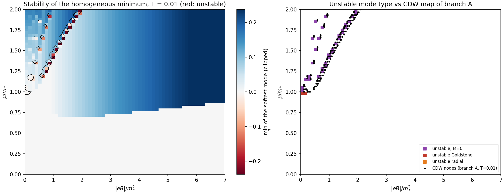
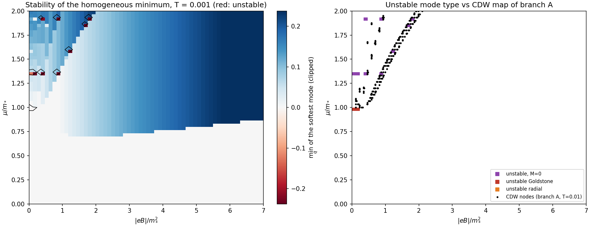

# B6. Карта устойчивости однородного состояния (предварительно)

Дата: 2026-11-07. План — [B0](00-plan.md); ядра — [B4](04-S2.md), [B5](05-fast.md). Код — `code/stab_map.py`, данные — `code/stab-map-T0.01.json`, `code/stab-map-T0.001.json`.

**Результат:** при $T=0.01$ однородное состояние неустойчиво относительно неоднородных флуктуаций **ровно там, где ветка A нашла CDW**: на полосе у первого порога заполнения $\mu^2\approx2eB$ и на островках у следующих порогов. Волновые векторы неустойчивости совпадают с $q=2b$ найденных спиралей. Неустойчивость возникает, когда $\mu$ лежит в окне шириной порядка $T$ около уровня Ландау; с понижением $T$ она усиливается, а окно сужается. Поэтому равномерная сетка 60×60 при $T=0.001$ ловит её лишь изредка, и для низких $T$ нужна сетка, привязанная к уровням.

## 1. Как считалось

- Сетка 60×60: $0<\mu\le2$, $0<eB\le7$; $T=0.01$ и $T=0.001$; около минуты на 4 ядрах.
- В каждом узле — сертифицированный однородный минимум $M_0$ ([заметка 19](../19-homogeneous.md)):
  - если $M_0>0$: голдстоуновская мода $\Phi_\pi(q)$ и радиальная $\Phi_\pi+2M_0^2R$;
  - если $M_0=0$: симметричное ядро $\tfrac12G(0^+)+\Pi(q)-\Pi(0)$ (регуляризующая масса $0.005\sqrt{eB}$; результат от неё не зависит в пределах $10^{-3}$).
- $q\in[0.05,3]$, 60 точек; в узел записываются $\min_q$ и его положение.

## 2. Карты

Слева — минимум по $q$ самой мягкой моды (красный — неустойчиво, контур — ноль). Справа — тип неустойчивой моды и CDW-узлы ветки A ([заметка 18](../18-adaptive-map.md), $T=0.01$) чёрными точками.

| $T$ | неустойчивых узлов: $M_0=0$ | голдстоуновская мода | радиальная мода |
|---:|---:|---:|---:|
| 0.01 | 32 | 2 | 1 |
| 0.001 | 9 | 2 | 0 |

## 3. Что видно

- **Совпадение с веткой A.** При $T=0.01$ все 32 неустойчивых симметричных узла лежат на полосе CDW и островках ветки A. Это два независимых расчёта: вторая вариация через уровни Ландау и прямая минимизация потенциала спирали через модель Раби.
- **Волновой вектор.** Например, при $\mu=1.05$, $eB=0.2$ (контрольная CDW-точка ветки A, $b\approx0.80$) неустойчивость на $q=1.6=2b$; при $\mu=1.5$, $eB=1.1$ — на $q=2.1$ (в ветке A $b\approx1.05$). Типичные $q$ — 1.4–2.0 при $T=0.01$.
- **Связь с уровнями Ландау.** Медианное расстояние от $\mu$ неустойчивых симметричных узлов до ближайшего уровня $\sqrt{2n\,eB}$ — 0.011 при $T=0.01$ и 0.0011 при $T=0.001$, то есть порядка $T$. Неустойчивость — это частично заполненный уровень Ландау; это аналог страйп-фаз двумерного электронного газа (ср. вопрос S4).
- **Зависимость от $T$** в узле $\mu=1.3667$, $eB=0.1167$ (уровень $n=8$ на 1.3663): $\min_q\Phi=+0.040$ при $T=0.01$, $-0.005$ при $0.003$, $-0.127$ при $0.001$, на $q\approx2.5$.
- **Неустойчивость однородных фаз.** При $\mu=1.0$ в фазах I₁, I₃ ($eB=0.233$, $0.117$) неустойчива голдстоуновская мода ($q\approx1.2$–$1.5$): это возле линии $\mu=m_*$, где при $B=0$ потенциал плоский.
- **Вакуумная фаза V устойчива** везде: голдстоуновская мода $\to0^+$ при $q\to0$, радиальная положительна.

## 4. Ограничения и что дальше

- **Разрешение по $\mu$ при низких $T$.** Окно неустойчивости шириной $\sim T$ около каждого уровня равномерная сетка почти не видит. Нужна сетка, привязанная к уровням: $\mu$ в окрестности $\sqrt{2n\,eB}$ (или $\sqrt{M_0^2+2n\,eB}$) с шагом $\lesssim T$, или адаптивное уточнение.
- **Диапазон $q$.** При $T=0.001$ часть минимумов на краю $q=3$; расширить до $q\sim4$ (таблица вакуума покрывает $q\le10\sqrt{eB}$).
- **Это локальная устойчивость.** Неустойчивость доказывает, что однородное состояние не основное. Устойчивость не исключает перехода первого рода в CDW: ветка A находит CDW и в узлах, где ветка B видит устойчивость (полоса CDW шире полосы неустойчивости).
- **Сверка при $T=0.001$** с картой ветки A при той же температуре ещё не сделана: CDW-карты при $T=0.001$ пока нет.
